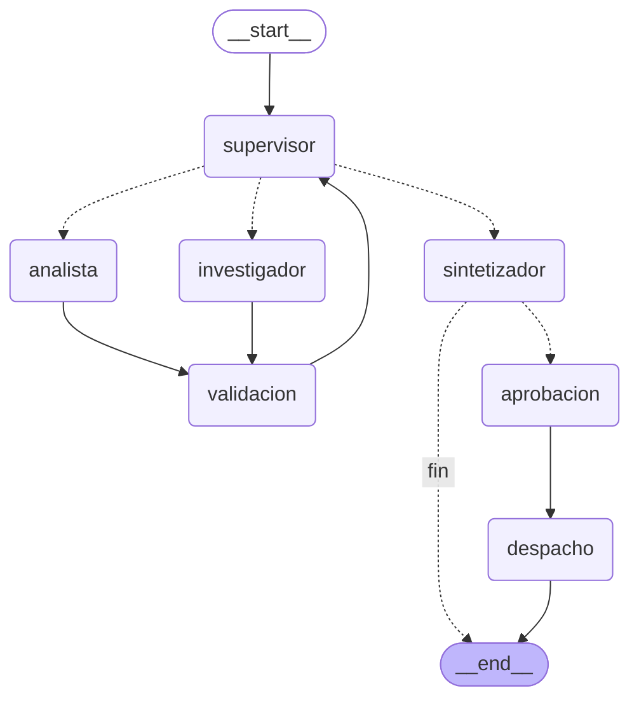

# Pre-entrega 7: API de produccion y monitoreo activo

API REST con **FastAPI** que lleva a produccion el orquestador multi-agente de
la Pre-entrega 6 (Modulo 7, CoderHouse - Desarrollo de aplicaciones con LLMs).
Una tarea no se resuelve dentro de la peticion HTTP: `POST /tasks` la guarda en
**Redis**, la encola y responde al instante con un `job_id`; un **worker** en
segundo plano ejecuta el grafo y deja el estado (`PENDING`, `RUNNING`,
`WAITING_APPROVAL`, `DONE` o `FAILED`) en Redis. Cada ejecucion se traza en
**Arize Phoenix** (costo y latencia incluidos), y una tarea **critica** (la que
pide *enviar* el informe a alguien) se pausa con `interrupt()` hasta que una
persona la aprueba (**Human-in-the-loop**).

Los agentes trabajan sobre la base simulada de resenas de clientes de la
Pre-entrega 6. Ejemplo: *"¿Que opinan los clientes sobre la entrega de los
auriculares y como es el sentimiento general?"*.

## Diagrama del grafo

El grafo es el de la Pre-entrega 6 mas un tramo final con aprobacion humana.



Las lineas punteadas son las **aristas condicionales**. Despues del
sintetizador, `ruta_tras_sintesis` decide: una tarea normal termina; una tarea
**critica** pasa por `aprobacion` (pausa) y recien despues por `despacho`, que
es la unica accion con efectos secundarios.

Si cambias la topologia, el diagrama se regenera desde el propio grafo. Hace
falta la API key en el `.env` (la configuracion la valida), pero no se hace
ninguna llamada al LLM:

```python
from app.config import cargar_configuracion
from app.graph import LLMs, crear_grafo
from app.llm import crear_llm

configuracion = cargar_configuracion()
llm = crear_llm(configuracion)
grafo = crear_grafo(LLMs(supervisor=llm, investigador=llm, analista=llm, sintetizador=llm), configuracion).compile()
print(grafo.get_graph().draw_mermaid())   # texto Mermaid para pegar en este README
# grafo.get_graph().draw_mermaid_png() devuelve la imagen (necesita internet: usa mermaid.ink)
```

## Arquitectura de la API

```
                         POST /tasks            RPUSH             BLPOP
   cliente ───────────▶  API (FastAPI)  ──────▶ Redis ◀────────── worker(s) ──▶ grafo LangGraph ──▶ LLM
      ▲   GET /tasks/{id}      │  estado job:<id>   cola          │  (python -m app.worker)  │
      │   POST .../approve     └────────────────▶ checkpoints ◀───┘                          │
      └──────── polling ◀───────────────────────── (AsyncRedisSaver, thread_id = job_id)     │
                                                                                             ▼
                                                               trazas OpenTelemetry ──▶ Phoenix (:6006)
```

Estados de un trabajo:

```
PENDING ──(un worker lo toma)──▶ RUNNING ──▶ DONE
                                    │
                                    ├──▶ WAITING_APPROVAL ──(POST /approve)──▶ PENDING ──▶ RUNNING ──▶ DONE
                                    │
                                    └──▶ FAILED   (excepcion, timeout o apagado del worker)
```

## Que hace

1. **`app/main.py`** — la API FastAPI: `POST /tasks`, `GET /tasks/{id}` y
   `GET /health`, e incluye el router de aprobacion. `crear_app()` recibe la
   funcion que abre los recursos, asi los tests la reemplazan por Redis falso y
   LLM falsos.
2. **`app/jobs.py`** — el estado de los trabajos y la cola sobre Redis
   (`JobStore`). El estado es un hash `job:<id>`; la cola es la lista
   `tasks:queue`. Los cambios de estado son atomicos (`WATCH`/`MULTI`).
3. **`app/worker.py`** — saca trabajos de la cola, ejecuta el grafo y deja el
   resultado o el error en Redis. Corre como proceso aparte o embebido en la
   API (`WORKERS_EMBEBIDOS`).
4. **`app/graph.py`** — el orquestador de la Pre-entrega 6 (`crear_grafo`) mas
   el tramo de aprobacion humana, compilado con el checkpointer de Redis
   (`compilar_orquestador`).
5. **`app/hitl.py`** — la regla de criticidad (`motivo_criticidad`), el nodo
   `aprobacion` (con `interrupt()`), el nodo `despacho` (el efecto secundario) y
   el endpoint `POST /tasks/{id}/approve`.
6. **`app/observability.py`** — inicializa Phoenix (`phoenix.otel.register` con
   instrumentacion de LangChain/LangGraph) y abre un span raiz por trabajo con
   el `job_id` como `session.id`.
7. **`app/runtime.py`** — abre Redis, el checkpointer y el grafo; lo comparten
   la API y el worker.
8. **`app/config.py` / `app/llm.py`** — configuracion validada al arrancar
   (`Settings`) y fabrica del LLM (OpenAI o Anthropic).
9. **`app/state.py`, `supervisor.py`, `validation.py`, `traza.py`,
   `knowledge_base.py`, `agents/`** — el orquestador de la Pre-entrega 6.
10. **`scripts/load_test.py`** — la prueba de carga: N peticiones concurrentes
    contra la API.
11. **`tests/`** — 73 casos de prueba (66 funciones `test_*`; una de
    `test_orquestador.py` esta parametrizada y genera 8 casos) con LLM falsos y
    Redis falso: no necesitan API key ni Docker. Son los 27 casos del
    orquestador de la Pre-entrega 6 mas API, worker (incluido `FAILED`), cola,
    aprobacion humana y observabilidad.
12. **`.github/workflows/ci.yml`** — integracion continua: en cada push corre
    `pytest` y `mypy --strict` en una maquina limpia con Python 3.12.

## Como correrlo

Requiere **Docker** y, para correr los tests, **Python 3.12 o superior**.

### Opcion A: Docker Compose (recomendada)

```bash
copy .env.example .env         # en Linux/Mac: cp .env.example .env
# editar .env y completar tu OPENAI_API_KEY (o LLM_PROVIDER=anthropic + ANTHROPIC_API_KEY)
docker compose up --build
```

Levanta cuatro servicios:

| Servicio  | Que es                                              | URL                          |
|-----------|-----------------------------------------------------|------------------------------|
| `redis`   | Redis Stack (Redis + RediSearch + RedisJSON)        | `localhost:6379`             |
| `phoenix` | Dashboard de observabilidad                         | http://localhost:6006        |
| `api`     | FastAPI (solo recibe, encola y consulta)            | http://localhost:8000/docs   |
| `worker`  | Ejecuta el grafo. Escalable: `--scale worker=3`     | —                            |

> Si ya tenes otro contenedor usando los puertos 6006 o 4317 (por ejemplo un
> Phoenix de otro ejercicio), frenalo antes con `docker stop <nombre>`.

Comprobar que esta todo bien:

```bash
curl http://localhost:8000/health
# {"status":"ok","redis":true,"pendientes_en_cola":0}
```

### Opcion B: la API sin Docker

Redis tiene que ser **Redis Stack** (el checkpointer usa RediSearch y
RedisJSON): `docker run -d -p 6379:6379 redis/redis-stack-server:7.4.0-v3`.

```bash
python -m venv venv
venv\Scripts\activate          # en Windows
# source venv/bin/activate     # en Linux/Mac
pip install -r requirements.txt
copy .env.example .env         # completar con tu OPENAI_API_KEY (o ANTHROPIC_API_KEY) real
uvicorn app.main:app --port 8000          # la API levanta 2 workers propios (WORKERS_EMBEBIDOS=2)
```

Para usar un proceso worker aparte: poner `WORKERS_EMBEBIDOS=0` en el `.env` y
correr `python -m app.worker` en otra terminal.

### Probar la API

| Metodo y ruta               | Que hace                                                                                   | Respuestas        |
|-----------------------------|--------------------------------------------------------------------------------------------|-------------------|
| `POST /tasks`               | Crea la tarea, la encola y devuelve el `job_id` sin esperar. Cuerpo: `pregunta`, `notificar_a` (opcional) | 202, 422          |
| `GET /tasks/{id}`           | Estado, resultado, error y, si espera aprobacion, el borrador a revisar                    | 200, 404          |
| `POST /tasks/{id}/approve`  | Decision humana (`aprobado`, `comentario`); reanuda el grafo pausado                       | 202, 404, 409     |
| `GET /health`               | Comprueba que la API llega a Redis                                                         | 200, 503          |

Con Swagger en http://localhost:8000/docs, o por consola:

```bash
# 1. Crear una tarea: responde enseguida con el job_id y status PENDING
curl -X POST http://localhost:8000/tasks -H "Content-Type: application/json" \
  -d '{"pregunta": "¿Que opinan los clientes sobre la entrega de los auriculares y como es el sentimiento general?"}'

# 2. Consultar el estado (repetir hasta DONE o FAILED)
curl http://localhost:8000/tasks/<job_id>
```

En PowerShell: `Invoke-RestMethod -Method Post -Uri http://localhost:8000/tasks -ContentType "application/json" -Body '{"pregunta": "Que dicen los clientes sobre la calidad de las zapatillas?"}'`
y `Invoke-RestMethod http://localhost:8000/tasks/<job_id>`.

### Probar el flujo Human-in-the-loop

Una tarea con `notificar_a` es **critica**: el sistema va a *enviar* el informe a
esa direccion (un efecto secundario irreversible), asi que se pausa antes.

```bash
# 1. Crear la tarea critica
curl -X POST http://localhost:8000/tasks -H "Content-Type: application/json" \
  -d '{"pregunta": "¿Que opinan los clientes sobre la entrega de los auriculares?", "notificar_a": "gerencia@empresa.com"}'

# 2. Consultar: queda en WAITING_APPROVAL y muestra el borrador en "aprobacion_pendiente"
curl http://localhost:8000/tasks/<job_id>

# 3. El revisor decide (aprobado: true envia el informe, false lo cancela)
curl -X POST http://localhost:8000/tasks/<job_id>/approve -H "Content-Type: application/json" \
  -d '{"aprobado": true, "comentario": "ok, mandalo"}'

# 4. Consultar: DONE, y "despacho" dice que se envio (o que se cancelo)
curl http://localhost:8000/tasks/<job_id>
```

El "email" lo simula el despachador dejando el mensaje en la lista `outbox` de
Redis: `docker compose exec redis redis-cli LRANGE outbox 0 -1`. Mientras la
tarea esta en `WAITING_APPROVAL` esa lista sigue vacia.

### Prueba de carga: 5 peticiones concurrentes

Con todo levantado:

```bash
docker compose exec api python -m scripts.load_test
```

(o desde tu maquina, con las dependencias instaladas: `python -m scripts.load_test`).
Lanza 5 peticiones **a la vez**, espera a que terminen y muestra la latencia de
cada una con p50, p95 y maximo, y lo que tardo cada `POST /tasks` en responder.
Acepta `--n` (cantidad), `--url` y `--salida resultados.json`.

Despues, en Phoenix (http://localhost:6006) → proyecto `pre-entrega-7`:

- **Costo por ejecucion**: pestana *Traces*, columna *total cost* (Phoenix la
  calcula sola con los tokens de entrada y salida y el precio del modelo). El
  costo acumulado esta en la pestana *Metrics*, panel *Cost*.
- **Latencia p95**: pestana *Metrics*, panel *Trace latency* (percentiles p50 a
  p99.9 y maximo). Se ve pasando el mouse sobre los puntos de la corrida; si la
  corrida quedo lejos en el tiempo, achicar la ventana arriba a la derecha
  (por ejemplo *Last 15 Min*).
- **Que nodo gasta mas tokens**: abrir una traza y mirar los spans `ChatAnthropic`
  de cada nodo (supervisor, investigador, analista, sintetizador).

Las capturas de una corrida real estan en `screenshots/`:

| Captura | Que muestra |
|---|---|
| `01-trazas-costo-y-latencia.png` | Las 5 trazas (una por trabajo) con latencia, tokens y costo de cada una |
| `02-traza-detalle.png` | Una traza abierta: orquestador → supervisor → investigador → ... con tiempo por nodo |
| `03-p95-y-costo-metricas.png` | Latencia p50 / p95 / p99 y costo de las 5 ejecuciones concurrentes |
| `04-llamada-llm.png` | Una llamada al LLM: prompt, respuesta, tokens y costo |

### Tests y tipado

```bash
pip install -r requirements-dev.txt
python -m pytest -q
python -m mypy --strict app tests scripts
```

Resultado esperado: `73 passed` y `Success: no issues found in 32 source files`.
Requiere **Python 3.12 o superior** y no necesita API key, Docker ni Redis (LLM
falsos y `fakeredis`), asi que corre igual en un `git clone` en limpio. El
mismo comando corre solo en GitHub Actions (`.github/workflows/ci.yml`) en cada
push.

Para usar Anthropic en vez de OpenAI, poner `LLM_PROVIDER=anthropic` y
completar `ANTHROPIC_API_KEY` en el `.env`.

## Estructura del repositorio

```
.
├── app/
│   ├── main.py               # API FastAPI: POST /tasks, GET /tasks/{id}, /health
│   ├── jobs.py               # estado de los trabajos y cola en Redis
│   ├── worker.py             # ejecuta el grafo en segundo plano (PENDING/RUNNING/FAILED/DONE)
│   ├── graph.py              # orquestador de la PE6 + checkpointer de Redis
│   ├── hitl.py               # criticidad, nodo de aprobacion (interrupt) y POST /tasks/{id}/approve
│   ├── observability.py      # Arize Phoenix: register + span raiz por trabajo
│   ├── runtime.py            # abre Redis, checkpointer y grafo
│   ├── config.py             # variables de entorno validadas (Settings)
│   ├── llm.py                # fabrica del LLM (OpenAI o Anthropic)
│   ├── state.py, supervisor.py, validation.py, traza.py, knowledge_base.py   # orquestador de la PE6
│   └── agents/               # investigador, analista, sintetizador y el subgrafo ReAct
├── scripts/load_test.py      # prueba de carga (5 peticiones concurrentes)
├── tests/                    # 73 casos (66 funciones) con LLM falsos y Redis falso (sin API key)
├── screenshots/              # capturas de Phoenix: trazas, costo por ejecucion y p95
├── .github/workflows/ci.yml  # CI: pytest + mypy en cada push
├── Dockerfile                # imagen de la API y del worker
├── docker-compose.yml        # redis-stack + phoenix + api + worker
├── requirements.txt          # dependencias con versiones fijadas
├── requirements-dev.txt      # suma pytest, pytest-asyncio, fakeredis y mypy
├── .env.example              # plantilla de variables de entorno (sin key real)
└── .gitignore                # excluye .env, venv/ y cachés
```

El codigo vive en `app/` y las pruebas en `tests/`, como pide la estructura de
referencia de la consigna.

## Ejemplo de salida esperada

Asi se ve el ciclo de vida de una tarea. Los ids y los tiempos cambian en cada
corrida, y el texto del informe puede variar segun el modelo.

`POST /tasks` responde enseguida (la API no espera al LLM):

```json
{"job_id": "c0a8…", "status": "PENDING", "pregunta": "¿Que opinan los clientes sobre la entrega de los auriculares…", "notificar_a": "", "resultado": null, "error": null}
```

`GET /tasks/{id}` mientras el worker trabaja y cuando termina:

```json
{"job_id": "c0a8…", "status": "RUNNING", "resultado": null, "error": null}
{"job_id": "c0a8…", "status": "DONE", "resultado": "Las opiniones sobre la entrega estan divididas: 2 resenas, sentimiento neutro y rating promedio de 3.5.", "error": null}
```

Tarea critica: pausa en `WAITING_APPROVAL` hasta la decision del revisor:

```json
{"job_id": "9f2b…", "status": "WAITING_APPROVAL", "aprobacion_pendiente": {"accion": "enviar_informe", "destinatario": "gerencia@empresa.com", "borrador": "…"}}
{"job_id": "9f2b…", "status": "DONE", "decision": {"aprobado": true, "comentario": "ok, mandalo"}, "despacho": "informe enviado a gerencia@empresa.com (envío 3f1c…)"}
```

Error en segundo plano (por ejemplo, una API key invalida): el cliente no queda
esperando para siempre.

```json
{"job_id": "5d29…", "status": "FAILED", "resultado": null, "error": "OpenAIAuthenticationError: Error code: 401 - …"}
```

Mientras tanto, el worker deja en su log la delegacion paso a paso (supervisor,
especialistas y validacion intermedia), con el `job_id` al inicio de cada linea
(`docker compose logs worker`). Lo que devuelven las herramientas sale de la
base simulada; las decisiones y la redaccion pueden variar segun el modelo:

```
[c0a8e1f2] [supervisor] paso 1: el LLM propone → investigador; decisión final → investigador
[c0a8e1f2]       razón: primero hay que conseguir los datos
[c0a8e1f2] [investigador] intento 1: encontró 2 reseña(s)
[c0a8e1f2]       · usa la herramienta buscar_resenas(consulta='entrega auriculares', max_resultados=2)
[c0a8e1f2] [validación] investigador: OK — cumple el contrato y las reglas de negocio
[c0a8e1f2] [supervisor] paso 2: el LLM propone → analista; decisión final → analista
[c0a8e1f2] [analista] intento 1: analizó 2 reseña(s)
[c0a8e1f2]       · usa la herramienta calcular_estadisticas(nombre='rating', valores=[5.0, 2.0])
[c0a8e1f2] [validación] analista: OK — cumple el contrato y las reglas de negocio
[c0a8e1f2] [supervisor] paso 3: el LLM propone → sintetizador; decisión final → sintetizador
[c0a8e1f2] [sintetizador] respuesta final: Las opiniones sobre la entrega están divididas: 2 reseñas, sentimiento neutro y rating promedio de 3.5.
[c0a8e1f2] terminado
```

Salida de la prueba de carga (corrida real, `claude-haiku-4-5`):

```
Enviando 5 peticiones concurrentes a http://localhost:8000 ...

 #  job_id                                estado    POST (ms)  total (s)
 1  ea0b85d7-8c79-4b4f-9b4d-a10d8d9a37e7  DONE           23.1      22.31
 2  c9afc9f8-46b3-42bd-942a-18828d45f691  DONE           31.2      25.34
 3  67feab48-2bbd-4f2e-9c7d-3e4ae1b750fa  DONE           30.0      24.33
 4  54a6cedd-d07e-404c-b1a3-fc7a3b930a00  DONE           29.4      18.22
 5  9dc9291b-b20b-4871-9e62-253a4b123158  DONE           31.6      32.40

Peticiones: 5 | DONE: 5 | FAILED: 0
Latencia total (cliente): p50 = 24.33 s | p95 = 32.40 s | máx = 32.40 s
El POST /tasks respondió en 32 ms como máximo: la API no espera al LLM.
Costo por ejecución y latencia p95 de la plataforma: abrí Phoenix (http://localhost:6006).
```

Lo que mostro Phoenix para esas mismas 5 ejecuciones (`screenshots/`):

| Metrica | Valor |
|---|---|
| Latencia p50 / p95 / p99 (por trabajo) | 24.05 s / 30.19 s / 31.25 s |
| Tokens totales | 80 370 |
| Costo total | ≈ US$ 0.12 |
| Costo por ejecucion | ≈ US$ 0.024 (entre 0.02 y 0.03 segun la pregunta) |

El p95 del cliente (32.40 s) es algo mayor que el de Phoenix (30.19 s) porque el
cliente cuenta tambien la espera en la cola y el intervalo de polling; Phoenix
mide solo el trabajo (span `job.ejecutar`).

## Por que una API asincrona con cola y worker

- **El LLM tarda segundos**: si el endpoint esperara la respuesta, cada peticion
  ocuparia una conexion durante todo ese tiempo. Con la cola, el endpoint hace
  dos operaciones de Redis y responde en milisegundos.
- **El cliente consulta cuando quiere**: `GET /tasks/{id}` solo lee un hash de
  Redis, asi que el polling es barato.
- **Los workers escalan aparte**: se agregan con `--scale worker=3` sin tocar la
  API, y cada worker procesa varios trabajos a la vez (`WORKER_CONCURRENCIA`).
- **El estado sobrevive a un reinicio**: vive en Redis (estado del trabajo y
  checkpoints de LangGraph), no en la memoria de un proceso. Para que tambien
  sobreviva a un reinicio de Redis, el `docker-compose.yml` lo levanta con AOF
  (`--appendonly yes`, cada escritura se registra en disco) y un volumen.
  Sin eso, Redis solo guarda snapshots cada tanto y un reinicio pierde lo ultimo.

## Como se manejan los errores en segundo plano

Si el grafo falla lejos del cliente, el trabajo no puede quedar en `RUNNING`
para siempre, porque el cliente haria polling infinito. Por eso el worker
siempre deja un estado final:

- Cualquier excepcion del grafo (incluido el limite de recursion) pasa el
  trabajo a `FAILED` con el motivo en `error`.
- Un timeout (`JOB_TIMEOUT_SEGUNDOS`) corta un LLM colgado y tambien lo deja en
  `FAILED`.
- Si el worker se apaga a mitad de un trabajo (Ctrl+C, `docker stop`), lo deja
  `FAILED` en vez de `RUNNING`.
- Una API key invalida (401/403) termina en `FAILED`: el orquestador degrada su
  respuesta ante fallas pasajeras del LLM, pero no disfraza un error de
  configuracion como si fuera un resultado.
- El bucle de cada worker sobrevive a errores de Redis y de un trabajo puntual.

## Como funciona la aprobacion humana

- **Que es una tarea critica**: la que pide *enviar* el informe a alguien
  (`notificar_a`), un efecto secundario irreversible. La regla vive en
  `motivo_criticidad` y se puede ampliar (por ejemplo, tareas de costo muy alto)
  sin tocar el grafo.
- **`interrupt()` antes del efecto secundario**: el nodo `aprobacion` pausa el
  grafo y el trabajo queda en `WAITING_APPROVAL` con el borrador exacto que se
  va a enviar. Al reanudar, LangGraph vuelve a ejecutar ese nodo desde su
  primera linea, asi que no hace nada con efectos antes del `interrupt`. El
  envio esta en otro nodo (`despacho`), que corre solo despues de la decision y
  no envia nada si fue rechazada.
- **Reanudacion**: `POST /tasks/{id}/approve` guarda la decision y vuelve a
  encolar el trabajo con `Command(resume=...)`. Lo puede tomar otro worker u
  otro proceso: para comprobarlo, con una tarea en `WAITING_APPROVAL`,
  reiniciar con `docker compose restart redis api worker` y aprobar despues; la
  tarea continua desde el checkpoint de Redis.

## Decisiones de diseno

- **El endpoint no bloquea el event loop**: el cliente de Redis, el LLM, las
  herramientas y el checkpointer son `async`; no hay llamadas sincronas dentro
  de la API. El exportador de Phoenix usa `batch=True` para no enviar trazas
  por red dentro del event loop.
- **Checkpointer asincrono (`AsyncRedisSaver`) y no `RedisSaver`**: la API y el
  worker corren sobre el event loop y el grafo se ejecuta con `astream`; el
  saver sincrono bloquearia el loop en cada checkpoint, que es justo lo que la
  consigna pide evitar. Necesita **Redis Stack** (RediSearch y RedisJSON), por
  eso `docker-compose.yml` usa `redis-stack-server`. Los checkpoints se
  inyectan desde `runtime.py`, asi que `graph.py` no cambia si el checkpointer
  cambia.
- **Se guarda el estado antes de encolar**: si fuera al reves, un worker rapido
  podria tomar un `job_id` que todavia no existe y el cliente veria un 404.
- **Transiciones atomicas**: pasar de un estado a otro es un
  *compare-and-set* (`WATCH`/`MULTI`). Dos workers no toman el mismo trabajo y,
  si dos revisores aprueban a la vez, uno recibe `202` y el resto `409`.
- **Solo se traza el grafo, no el polling**: se instrumenta LangChain/LangGraph
  y se apaga la telemetria HTTP de FastAPI (`telemetry={"tracing": False}`). Si
  no, cada `GET /tasks/{id}` seria una traza de milisegundos y distorsionaria el
  costo promedio y la latencia p95. El span raiz de cada trabajo lleva
  `session.id = job_id`.
- **Fuente caida vs "sin resultados"** (leccion de leer las trazas en Phoenix):
  `buscar_resenas` lanza `ToolException("FUENTE_CAIDA ...")` cuando la fuente
  falla (span en **ERROR**, y se reintenta) y devuelve `estado: "sin_resultados"`
  cuando simplemente no hay datos (span OK, no se reintenta). Ademas, la
  validacion acepta el promedio global o el de un producto en las comparaciones
  (`tests/test_dominio.py`).
- **Limitaciones conocidas**: la cola usa `BLPOP` (como mucho una entrega): si un
  proceso muere de golpe (`kill -9`) con un trabajo en curso, ese trabajo queda
  sin cerrar; el apagado ordenado si esta cubierto. Una cola con acuse de recibo
  (Streams, Arq o Celery) lo resolveria. El envio del informe es una simulacion
  (lista `outbox` en Redis). Evolucion natural hacia produccion: cambiar la cola
  por Redis Streams o Arq, y el checkpointer por `AsyncPostgresSaver` si hace
  falta durabilidad en disco, sin tocar el grafo.
- **Configuracion validada al arrancar** (`config.py`) y **versiones fijadas**
  en `requirements.txt`, igual que en el resto de las entregas.
- **`.env` fuera del repo**: la API key real nunca se sube; solo se versiona
  `.env.example`.
- **Comentarios linea por linea**: un comentario arriba de cada import y de cada
  funcion/clase explicando el porque.
